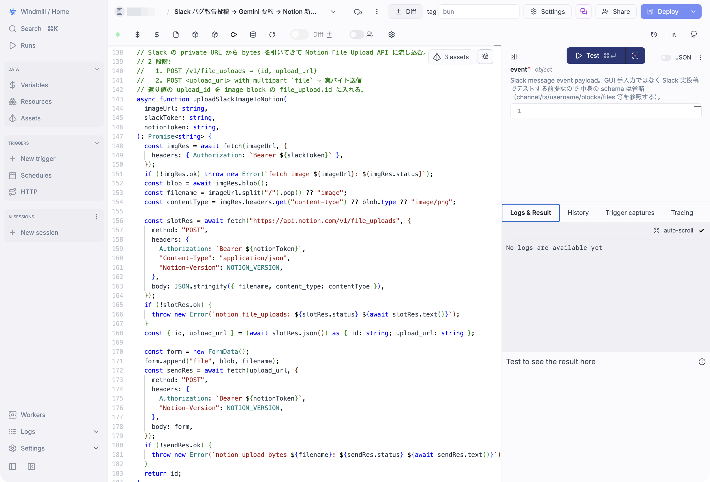

## はじめに

ワークフロー自動化ツールは、スマートホーム向きのIFTTT、業務SaaSを繋ぐZapier、ここ1〜2年はn8nなどがよく知られています。しかし、ビジュアルノードをつなぎ合わせるワークフローは、処理が複雑になるとノードが増え、管理や編集が大変になります。その帰結としてコードノード（JavaScript や Python）に処理を集めてしまう状況に陥りがちです。

ならば、そもそもワークフロー全体をコードで記述できれば良いのではないか。ましてやコーディングエージェントがコードを書ける現代です。Git で差分を管理できるべきでしょう。そう考えて n8n から Windmill に移行し、2026年の半ばから運用を続けてきました。

この記事では、代表的なワークフロー自動化ツールと Windmill を比較し、Windmill を選んだ理由、実際に運用して感じたメリット、そして Cloud 版とセルフホスト版の選び方について解説します。

### 定義と範囲

今回取り上げるワークフロー自動化ツール[^naming]は、Slack や Notion などの外部 SaaS・データベース・スマート家電を連携する処理を構築でき、スケジュール（cron）や Webhook をきっかけに動作し、認証情報や実行ログをまとめて管理する機能が、1つにパッケージされたツールやサービスです。

なお、近い用途で使われるデータオーケストレーションや耐久実行（Durable Execution）のツールも、比較対象として取り上げます。

Google Cloud Functions や AWS Lambda などのサーバーレス関数（FaaS）は対象外とします。個別の機能はあるものの、自前で組み合わせて管理する必要があり、手離れが悪いためです。

また、画面操作を自動化する RPA（Robotic Process Automation）は取り上げません。
## ワークフロー自動化ツールの比較

2026年現在、業務自動化やオーケストレーションの領域には多様なツールが存在します。いずれも、AI・ワークフロー・オーケストレーションといったキーワードを掲げており、公式サイトの勇壮な紹介文だけでは機能の違いが見えません。そこで、まず重視する4つの要件を定め、それに沿って公式ドキュメントなどを確認しました。

1. **認証情報を使い回せる**：
   Slack や Google Cloud（GCP）の認証情報（シークレットや OAuthトークン）を一度登録すれば、すべてのワークフローから安全かつ透過的に参照できる。
2. **フローをまとめて管理できる**：
   多数のワークフローのスケジュール、実行状態、実行ログ、ステップごとの入出力を1つのダッシュボードで横断して確認・監視できる[^schedule]。
3. **コード主体で Git 管理できる**：
   ビジュアルノードを手作業で並べるのではなく、TypeScript や Python のコードとして処理を記述できる。それにより、Git の差分としてレビューでき、コーディングエージェントに生成や修正を任せやすい。
4. **セルフホスト可能**：
   この領域は、サービスの統廃合や規約・料金の改定が頻繁に起こります。いざというときに、コードと実行環境ごと手元へ移行できることは安心につながります[^lockin]。

### 比較表

| 製品                          | 類型            | 書き方              | 認証機構  | Git での管理          | セルフホスト（ライセンス）              |
| --------------------------- | ------------- | ---------------- | ----- | ----------------- | -------------------------- |
| [Windmill](https://www.windmill.dev) | ワークフロー自動化     | コード (多言語)        | OAuth連携  | `wmill sync`（CLI） | 可（AGPLv3、一部独自[^proprietary]） |
| [n8n](https://n8n.io) | ワークフロー自動化     | ノードUI            | OAuth連携  | Business プラン以上    | 可（Sustainable Use License） |
| [Zapier](https://zapier.com) | ワークフロー自動化     | ノードUI            | OAuth連携  | なし（JSON 出力のみ）     | 不可                         |
| [Activepieces](https://www.activepieces.com) | ワークフロー自動化     | ノードUI            | OAuth連携  | 最上位プランのみ          | 可（MIT、一部商用）                |
| [Pipedream](https://pipedream.com)（提供終了）[^pipedream] | ワークフロー自動化     | ノードUIとコード        | OAuth連携  | GitHub と同期        | 不可                         |
| [Prefect](https://www.prefect.io) | データオーケストレーション | コード (Python)     | 保管庫のみ | コードそのもの           | 可（Apache-2.0）              |
| [Dagster](https://dagster.io)（買収）[^dagster] | データオーケストレーション | コード (Python)     | 要自前実装 | コードそのもの           | 可（Apache-2.0）              |
| [Temporal](https://temporal.io) | 耐久実行          | コード（多言語）         | 要自前実装 | コードそのもの           | 可（MIT）                     |
| [Trigger.dev](https://trigger.dev) | 耐久実行          | コード (TypeScript) | 要自前実装 | コードそのもの           | 可（Apache-2.0）              |
| [Inngest](https://www.inngest.com) | 耐久実行          | コード (多言語)        | 要自前実装 | コードそのもの           | 可（SSPL）                    |
| [Restate](https://restate.dev) | 耐久実行          | コード (多言語)        | 要自前実装 | コードそのもの           | 可（BSL 1.1）                 |
| [Dify](https://dify.ai) | LLM アプリ開発     | 画面中心             | OAuth連携  | なし（DSL 書き出し）      | 可（改変 Apache-2.0）           |

- **類型**：**ワークフロー自動化**は、外部サービスの認証管理、GUI、スケジュール実行、実行ログ保存などを単体で備えるもの。**データオーケストレーション**は、依存関係のある一連のデータパイプラインを順序立てて実行・管理するもの。**耐久実行**は、自作アプリに組み込む部品で、処理が途中で落ちても中断したステップから再開できる耐障害性を提供するもの。**LLM アプリ開発**は、LLM を活用したプロンプトチェーン、RAG パイプライン、AI エージェントの構築に特化したもの。
- **認証機構**：「**OAuth連携**」は、連携先の認可とトークンの更新をサービスが行う。「**保管庫のみ**」は自分で取得した API キーなどを保管する場所が用意されている。「**要自前実装**」は環境変数や Secret Manager などで自分で管理する。

### 比較表の解説と補足

この比較表からは「OAuth連携があり、コード主体で書けて Git で管理でき、セルフホストもできる」という条件をすべて満たすのは、Windmill だけということが読み取れます。

### 代表的なツール

それぞれの代表的なツールについて、選定を見送った理由を詳しく掘り下げます。

#### Zapier

ワークフロー自動化の代表格であり、SaaS 連携の豊富さは随一です。しかし、セルフホストは不可能であり、Git で同期する仕組みも存在せず、コードステップ（ノード）も補助的です[^zapier-code]。

#### Dify

LLM アプリケーションの構築に特化しており、RAGパイプラインや AI エージェントのプロトタイピングは得意です。しかし、複数の外部 SaaS を連携させてデータを定期処理するような汎用的な業務自動化とは、目的が異なります。また、アプリの定義は DSL（YAML）としてエクスポートできますが、Git リポジトリと同期する公式の仕組みは見当たりません。

#### n8n

優れたビジュアル UI を備え、セルフホストも可能な非常に人気の高いツールです。しかし、n8n の Git 連携機能は高額かつ動作が限定的です。年払いで月667ユーロの Business プラン以上でしか使えません（[n8n pricing](https://n8n.io/pricing/)）。さらにこの機能は、開発環境から本番環境のインスタンスという一方向にワークフローを移動するためのものであり、公式ドキュメントでも同じインスタンスで push と pull の両方をすることは非推奨とされています（[Push and pull changes](https://docs.n8n.io/administer/use-source-control-and-environments/push-and-pull-changes)）。

API や CLI でワークフローの JSON をGit管理する運用も候補にはなりますが、コードは巨大なJSONの中にエスケープ文字列として埋め込まれるため、差分を読んでレビューするには向きません。
## Windmill を使って良かった点

「機能として存在する」ことと「日々の実用において快適に使える」ことは別物です。実際に n8n から Windmill に移行して運用する中で実感した、具体的なメリットを4つ紹介します。

### 処理の見通しが良い

処理のモジュール化が進み、見通しが良くなりました。例えば、Slack の投稿をきっかけに動く自動化が2つあるとします。

- バグ報告チャンネルに投稿があったら、Notion に不具合チケットを起票する
- 電話履歴チャンネルに投稿があったら、担当チームのチャンネルへ転送する

Slack はアプリ1つにつきイベント送信先を1つしか設定できません。そのため n8n では、異なる複数の処理を1つのワークフローに同居させる必要がありました。結果としてワークフローは巨大になり、管理や編集が大変になります。

Windmill では、薄いルーター役のフローを作成し、そこから独立したスクリプトに個別の処理を振り分けられます。それぞれのスクリプトは、管理画面や手元のエディタから単体でテスト実行でき、失敗時の個別再実行も容易です。
### シンプルなコードへの集約

複雑な多段ステップの処理を、数百行ほどのスクリプトとしてコンパクトに記述できるようになりました。前述のバグ報告の起票を例にすると、投稿を読み取り／Gemini で要約と分類をして／Notion にチケットを作り／添付の画像を貼って／Slack のスレッドに URL を返すステップがあります。n8n ではノードが20〜30ほど必要でしたが、Windmill では約450行の TypeScript 1本になりました。

### Git 管理できる

バージョン管理の恩恵を受けることができます。CLI ツール（`wmill`）を使うことで、ダッシュボード上のスクリプトやフロー定義を、ローカルのファイルと双方向に同期できます。

業務や生活で日常的に動かす自動化では、挙動がおかしくなったとき、どの変更が原因だったかを素早く特定できることは重要です。Git で管理されていれば、変更の追跡や、安全な状態へのロールバックが容易です。
### コーディングエージェント向き

AIコーディング環境との親和性があります。CLIツールからコーディングエージェント向けの手引き（`AGENTS.md` やプロンプトファイル）を作業ディレクトリに導入できます。この手引きには、Windmill 特有のスクリプトの書き方や運用ルールが説明されており、コーディングエージェントが書き方に迷ったり、試すつもりで本番に反映したりする失敗が減ります。
## Cloud かセルフホストか

Windmill には、公式が提供するマネージドサービス「Windmill Cloud」を利用するか、自分のサーバーに構築する「セルフホスト（Community Edition）」を選ぶか2つの選択肢があります。どちらが経済的・運用的に有利かは、ワークフローを編集する人数と、定期実行タスクの頻度で決まります。

| 項目/月         | Cloud の Free | Cloud の Team | セルフホスト  |
| ------------ | ------------ | ------------ | ------- |
| 費用           | 0ドル          | 1シート10ドル     | 16〜20ドル |
| 実行件数[^count] | 月1,000件      | 1シートあたり月1万件  | 上限なし    |
| ユーザー数        | —            | 最大10シート      | 50人まで   |

Cloud の料金は執筆時点です（[Windmill の料金](https://www.windmill.dev/pricing)）。セルフホストの金額は、私が作ったテンプレートで GCE に立てた場合です。

目安になるのは、定期実行の件数です。5分ごとのスケジュールが1本あると、月に約8,640件（1日288回 × 30日）になり、Free の上限を超えます。1分ごとなら約4万3千件で、Team の5シート分です。実行件数のためにシートを追加購入することになります。

セルフホストの16〜20ドルは、Team の2シート分です。つまり目安として、編集するメンバーが3人以上いるか、実行件数が月2万件を超えるなら、セルフホストのほうが経済的になります。認証情報や実行ログ、データをすべて自分の環境に置けるメリットもあります。

1〜2人で使い、定期実行も少ないならば、Cloud 版のほうが安く、セキュリティやインフラ保守の手間もなく良いでしょう。

まずは手軽な Cloud 版の Free プランで PoC（概念実証）を試し、定期実行タスクや関わる人数が増えてきた段階でセルフホストへ移行する、というステップを踏むのもおすすめです。

セルフホストを選択した場合の、テンプレートの仕組みと、長期運用で表面化する問題への対策は、別記事 [Windmill を GCE で長期間安全にセルフホストする](/note/rzom47ia) で詳しく解説しています。

## おわりに

ビジュアルノードを配置してつなぐノーコード／ローコードツールは、手軽に自動化を始められる素晴らしいツールです。しかし、業務の成長に伴って処理が複雑化していくと、いずれ「コードで書き、Git で管理したい」という壁に突き当たります。

Windmill は、その壁を乗り越えるための有力な選択肢です。ビジュアルツールとしての親しみやすさは n8n や Zapier に一歩譲るものの、TypeScript・Python・Golangでロジックを書き、Git でレビューし、コーディングエージェントと協調して開発保守することができます。

ワークフローの管理やノードの複雑怪奇なスパゲッティ化に悩んでいる方は、ぜひ一度 Windmill を試してみてください。

[^schedule]: スケジュールと実行ログは、表のほぼすべての製品にあるため、列にはしていません。Restate だけは組み込みの cron がなく、自前で組みます。

[^lockin]: 表の12件だけでも、提供終了（Pipedream）と買収（Dagster）がありました。

[^pipedream]: Pipedream は Workday に買収され（2025年11月に合意）、Workflows は2027年3月31日に提供を終えます。新規の受付はすでに止まり、データは2027年4月30日までに消えます（[Pipedream の資料](https://pipedream.com/docs/workflows)）。

[^dagster]: Dagster は2026年7月に Prefect に買収されました。製品とオープンソースのライセンスは残るとのことです（[Dagster の告知](https://dagster.io/prefect)）。

[^zapier-code]: 言語は JavaScript と Python のみで、1ステップの実行時間は Free で1秒、Professional でも30秒までに制限されています。

[^count]: 件数は、1秒未満のジョブ1回で1件と数え、1秒を超えるジョブは秒数のぶんだけ件数として数えます。フローは、各ステップの件数の合計です。シートは、スクリプトやフローを編集する人（builder）が1人で1シート、実行や閲覧だけの人が1人で半シートです。

[^proprietary]: Windmill の Community Edition の Docker イメージには、AGPLv3 以外の独自ライセンスのコードが含まれます（[Windmill LICENSE](https://github.com/windmill-labs/windmill/blob/main/LICENSE)）。

[^naming]: 決まった呼び方はなく、「iPaaS（Integration Platform as a Service）」「ワークフローオートメーション」「ワークフローエンジン」「ノーコード自動化」「業務自動化」「オーケストレーションツール」などとも呼ばれます。
